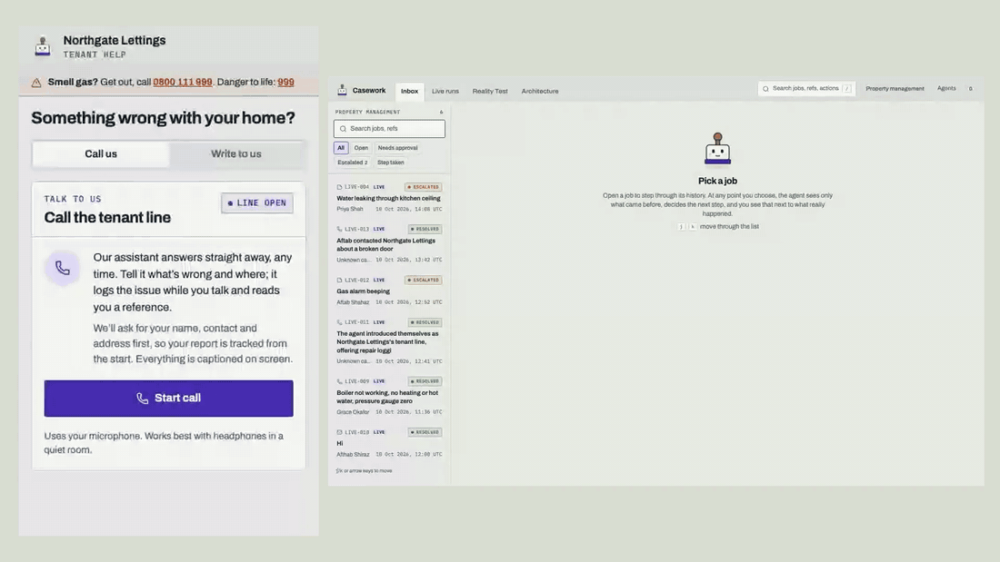
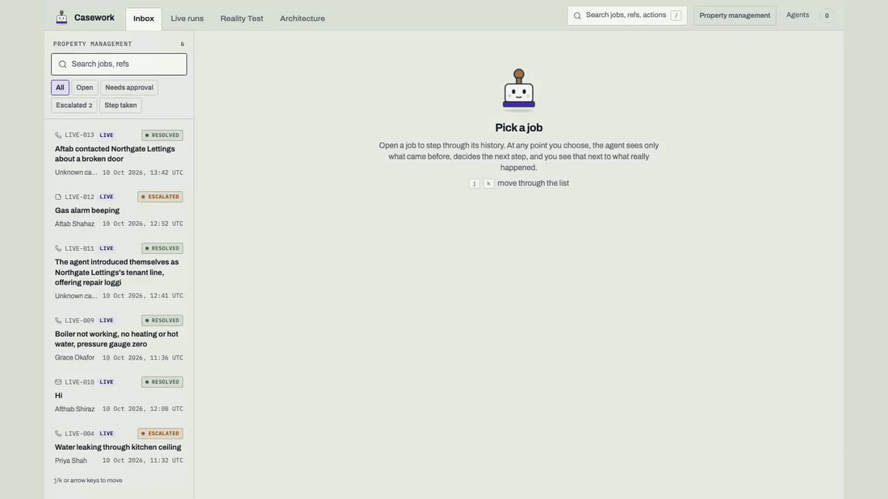
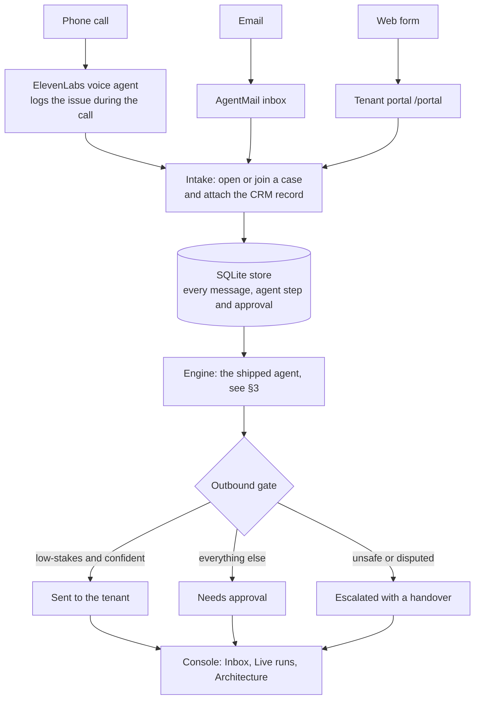
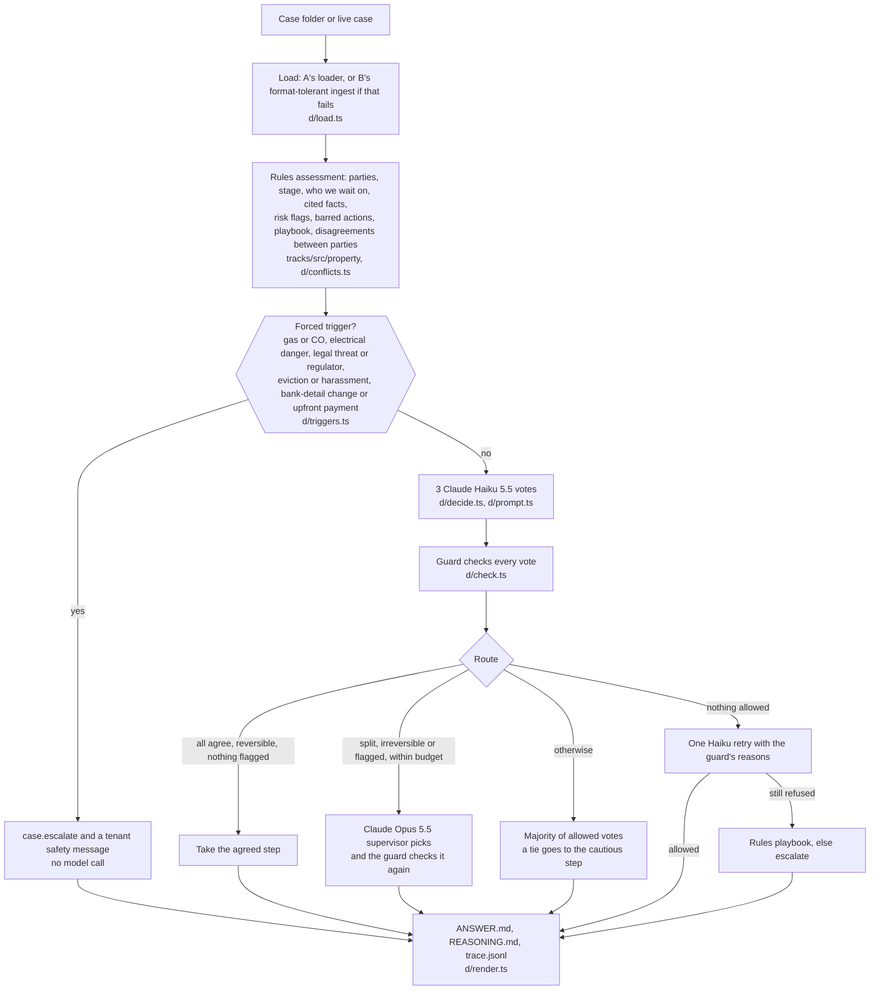
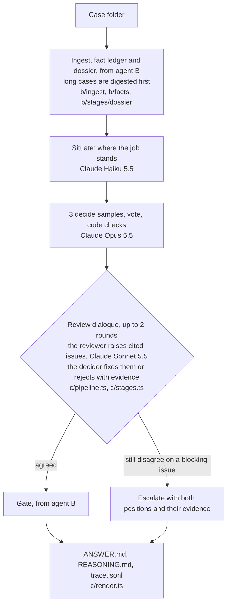

# Casework

**One inbox for a letting agency's maintenance work, with an AI agent on every case and a person on
every decision that matters.**

Tenants phone, email or use a web form. Each message becomes a case in one console, joined to the
caller's existing case when there is one. An AI agent reads the whole conversation, works out where
the job stands and proposes the agency's single best next step. Low-stakes replies to the tenant go
out on their own. Anything else waits for a person to approve with the full context beside it:
landlord approvals, contractors, money, safety, complaints, low confidence. When the agent shouldn't
act at all, it escalates with a handover a person can decide from in seconds.

The same engine also runs unattended over a folder of cases and writes `ANSWERS/` for the hackathon's
Reality Test.

Track: **Property Management** · Submission details: [SUBMISSION.md](SUBMISSION.md) · Live demo
script: [how_to_demo.md](how_to_demo.md) · Reality Test results: [ANSWERS/](ANSWERS/)

## See it working

Screen recordings of the real product, running against the live store. Nothing is staged or edited,
apart from cutting idle time.

**1. A tenant reports a leak from their phone; it is a live case in the console seconds later.**
The portal (left, phone size) sends the report. The console (right) opens case LIVE-015, the agent
runs, and it proposes asking the landlord to approve a repair. That commits the landlord's money, so
the draft waits under *Needs approval* with the reasons shown.



**2. An emergency from a voice call: what happens next.** Afthab (shown as "Aftab Shahaz", as the
speech-to-text heard it) called the voice line from his phone about a beeping gas alarm. The voice
agent logged the issue during the call (case LIVE-012). A gas alarm is a forced trigger, so the agent
escalated without sending anything on its own. The recording walks through the call transcript, the agent's
steps, the handover (what is known, the options with the recommended one first), and the drafts that
carry out the coordinator's decision: an urgent Gas Safe visit for the contractor, a notice for the
landlord and safety advice for the tenant, each held for approval.



Full-quality versions: [phone-to-console.mp4](docs/media/phone-to-console.mp4),
[gas-emergency.mp4](docs/media/gas-emergency.mp4), and a narrated 56-second cut of both,
[walkthrough.mp4](docs/media/walkthrough.mp4). The submission demo video is [demo/demo.mp4](demo/demo.mp4).

---

## 1. The problem

Real-world operations are rarely clean. A single boiler repair at a letting agency involves a tenant,
a landlord and a contractor, across phone calls, emails, texts, quotes, invoices and CRM notes. The
information is incomplete, people change their minds, systems fail and rules conflict. Today a
coordinator re-reads every thread to work out what's happening, then decides who to chase.

Casework does the reading and the routine moves, and knows when to stop:

- **Continue on its own** when the step is low-stakes and well supported, e.g. acknowledge the
  tenant or ask for a photo.
- **Ask for more information** when something's missing or two parties disagree on a fact the next
  step depends on.
- **Stop and involve a person** for safety risks, disputes, legal threats, money, conflicting facts,
  or anything a policy rule forbids. The person gets the case, the agent's reasoning with cited
  sources, why it stopped, and the options.

## 2. What it does



| Capability | How |
|---|---|
| **Voice** | An ElevenLabs Conversational AI agent answers as the agency's tenant line. Mid-call it calls our `log_issue` tool, so the case appears while the caller is still talking. The post-call webhook (HMAC-verified) files the full transcript and the agent re-runs. A poller files calls that no webhook delivered. |
| **Email** | A real inbox (AgentMail, e.g. `casework-lettings@agentmail.to`). New mail becomes a case within about 10 s. Replies are sent in the same thread. A follow-up joins the existing case by thread, then by sender. |
| **Tenant portal** | `/portal`: a "Call us" button (browser voice call) and a report form, built for phones first. Before a call the caller types their name, contact and address, so the case opens under them at once and the assistant greets them by name. |
| **Approvals** | The *Needs approval* inbox filter. Each case's **Review messages** tab shows why the gate held the message, the draft in an editor, and who's involved. Approve & send, or reject. |
| **Escalations** | The *Escalated* filter. A handover card shows the situation, known and missing facts, options with the recommended one first, and the risks. Once a person decides, the messages that carry the decision out (tenant, landlord, contractor) are drafted and held for approval. |
| **One record** | Every message, every agent run (each step, tool call and refusal), every outbound message and every human decision is stored and survives restarts. "Delete" hides a case (with Undo) but keeps its history. |
| **Transparency** | **Architecture** tab: the system diagram; the **rules** rendered from the code that enforces them; the agent's **tools**; **cost** per case, autonomy rate and person-time saved; the **directory**. |

## 3. Architecture

```
apps/web          Next.js: console, tenant portal, channel adapters (voice, email), API routes, SSE
apps/cli          Reality Test runner (`pnpm reality`), eval, replay and the bench harness
packages/agents   The engine: one interface over agents A–D, bench, few-shot memory
packages/core     Schemas, agent A's guarded tool loop, policy guard, run reducer, ANSWERS writer
packages/tracks   Track packs: case loader, rules, tools, policy, prompt, vocabulary (property is live)
packages/evals    Labelled cuts, checks (including a lint that keeps injected instructions out of outputs)
```

**One engine, two front ends.** `getEngine(id).run(case, pack, ctx)` (`packages/agents/src/engine.ts`)
is the only way a case is run. The live product calls it when a call or email arrives; `pnpm reality`
calls it over a folder of cases. A live case that never had a folder is written out in the organisers'
case layout first, so every agent reads it like a supplied case.

| | Live product (`apps/web`) | Reality Test (`apps/cli`) |
|---|---|---|
| Input | calls, emails, portal → SQLite store | case folders in `data/challenges/` |
| Around the engine | CRM context, persistence, outbound gate, approvals, live updates | nothing live: unattended, no network channels |
| Output | sent / held / escalated, visible in the console | `ANSWERS/<n>/ANSWER.md`, `REASONING.md`, `trace.jsonl` |

Every agent implements the same interface, so any of them can sit behind the engine. Pick one with
`ENGINE=<id>` (product and CLI) or `pnpm reality --agent <id>`. Two earlier designs stay in the repo as
baselines and building blocks:

| Agent | Idea | Code |
|---|---|---|
| **A** | Deterministic property rules + Claude Haiku 5.5 choosing one of 14 action tools in a guarded tool loop | `packages/core/src/agent`, `packages/tracks/src/property` |
| **B** | Fixed pipeline: format-tolerant ingest, fact ledger, three decide samples, code checks, a critic, a gate | `packages/agents/src/b` |

The current agent is described in its own section below, with its models, settings and results.

<!-- agent-d:start -->
### Agent D

The default engine (`ENGINE=d`, `--agent d`).



- **Forced triggers** count only recent words from a tenant, landlord or contractor, and skip negated
  mentions ("no smell of gas"). Text that tries to instruct the agency (prompt injection inside a case)
  is shown to the models as a warning; it is never a reason to escalate on its own.
- **Votes, not self-reported confidence.** Agreement between the three votes is the uncertainty
  signal.
- **The supervisor** runs only when the votes split, the step is irreversible (close, assign,
  instruct), the rules flagged something or a warning is open. It is capped per process at
  `AGENT_D_SUPERVISOR_MAX_CALLS` (default 200) and `AGENT_D_SUPERVISOR_MAX_USD` (default 25);
  `AGENT_D_SUPERVISOR=off` turns it off.
- **The guard has the last word**, in order: forced trigger means escalate only; a deny-list (tenant
  fees, bank details or door codes, promises, compensation or admissions, "safe to use"); an ask must
  name the missing fact and an escalation its trigger; the shared core guard (assessment bars and pack
  policy); D's contracts (no second approval request, no second contractor, instruct only after an
  approved quote, send a quote only when a new one exists); every £ figure in a message must appear in
  the case; while parties disagree on a fact the next step depends on, no assign, instruct, quote or
  close.
- **Never stalls a batch.** Each case has a deadline (`AGENT_D_CASE_TIMEOUT_MS`, default 240 s). A
  failed call, schema error or timeout is recorded under "What failed" and the case still gets an answer.

**Models.** Claude Haiku 5.5 (`claude-haiku-5-5`) for the three votes and the retry; Claude Opus 5.5
(`claude-opus-5-5`) for the gated supervisor.

**Settings** (all in [.env.example](.env.example)): `AGENT_D_SAMPLES` (votes, default 3),
`AGENT_D_EFFORT` (`high`), `AGENT_D_SUPERVISOR` (`on`), `AGENT_D_SUPERVISOR_MODEL`,
`AGENT_D_SUPERVISOR_MAX_CALLS` (200), `AGENT_D_SUPERVISOR_MAX_USD` (25), `AGENT_D_CASE_TIMEOUT_MS` (240000).

**Results** (one run each; summaries in [docs/evals/](docs/evals/)):

| Set | Acceptable next step | Prohibited step |
|---|---|---|
| Test split, 66 cuts ([d-test](docs/evals/d-test.md)) | **87.9%** | 0.0% |
| Validation split, 71 cuts ([d-val](docs/evals/d-val.md)) | 83.1% | 1.4% |
| Perturbation suite, 120 damaged copies of val + test cuts ([d-perturbation](docs/evals/d-perturbation.md)) | 85.0% | 2.5% |
| Stress suite, 52 team-written cases in `data/outside` ([d-stress-suite](docs/evals/d-stress-suite.md)) | 90.4% | 0.0% |

D builds on rules tuned on all 50 example cases, so the val and test scores are in-sample. The test
run cost about $0.02 per cut. Known weakness: on some conflicts where escalating would also be
acceptable, D picks a routine step instead (stress cases 107, 111, 114, 130).

Design notes and every measurement behind these choices: [docs/plan/12-agent-d.md](docs/plan/12-agent-d.md).
<!-- agent-d:end -->

<!-- agent-c:start -->
### Agent C

Run it with `ENGINE=c` or `--agent c`.



C adds a property addendum to B's domain manual (`packages/agents/src/c/knowledge/property.md`): query
conflicting details before acting on them, confirm price and scope before the visit, a new question is
not a chase, and similar refinements.

**Models.** Claude Haiku 5.5 (`claude-haiku-5-5`) reads, Claude Opus 5.5 (`claude-opus-5-5`) decides,
Claude Sonnet 5.5 (`claude-sonnet-5-5`) reviews. Set them with `AGENT_C_MODEL_READ`,
`AGENT_C_MODEL_DECIDE` and `AGENT_C_MODEL_CRITIC` (see [.env.example](.env.example)).

**Results.** No benchmark summary for C is committed yet.
<!-- agent-c:end -->

### Outbound gate (live product)

`apps/web/src/server/live/intake.ts`. A message is sent automatically only when all of these hold: it's
a tenant acknowledgement, update or question; confidence is at least 70%; the run didn't escalate; no
policy rule blocked an action; the recipient has an address and a live channel. Everything else is
held, with the reasons shown to the reviewer.

One run in the event stream: `run.started → step.read → case.assessed → tool.called / action.blocked →
decision.made → escalation.created? → next.proposed → run.completed`. More:
[docs/plan/03-architecture.md](docs/plan/03-architecture.md).

## 4. How to run it

Prerequisites: Node 22 or later, pnpm 10, Git LFS (the demo video), and `cloudflared`
(`brew install cloudflared`) or `ngrok` for the voice webhooks.

```bash
git clone --recurse-submodules https://github.com/Harrishayy/monopoly.git   # or: git submodule update --init
git lfs pull
pnpm i
cp .env.example .env          # add ANTHROPIC_API_KEY, ELEVENLABS_API_KEY, AGENTMAIL_API_KEY
pnpm email:setup              # once: creates the agency inbox and writes AGENTMAIL_INBOX
pnpm demo                     # console on http://localhost:3100 (inbox at /inbox, portal at /portal)
pnpm tunnel                   # separate terminal: public URL + points the ElevenLabs agent at it
                              # (or pnpm tunnel:ngrok; share <url>/portal so others can call in)
```

`pnpm tunnel` creates or updates the ElevenLabs agent, its tool and webhook through the API
(`scripts/voice-setup.mts`); no dashboard clicks are needed. The full demo walkthrough is in
**[how_to_demo.md](how_to_demo.md)**.

Checks: `pnpm typecheck && pnpm test && pnpm build`.

### Reality Test (unattended)

Copy the released cases so that `data/challenges/Property Management/001/index.md` exists (see
[data/README.md](data/README.md)), then:

```bash
pnpm reality --track property --in data/challenges --out ANSWERS     # the default agent
pnpm reality --track property --in data/challenges --out ANSWERS --agent a   # any other agent
```

Each case gets `ANSWERS/<n>/` (folder `007` → `ANSWERS/7/`), written as soon as it finishes:

- `ANSWER.md`: an "At a glance" block (what the system received, actions taken, actions the guard
  refused, whether it escalated, what failed, the final result), then the next step and who it goes to, the message, why (with cited source ids), the
  handover when it escalates, open disagreements, boundaries, what is still open, how it was decided
  and whether anything was delivered, and what failed.
- `REASONING.md`: the route taken, forced triggers and warnings, every vote, the supervisor's review,
  guard refusals, the decision, and every model call with tokens and estimated cost.
- `trace.jsonl`: the full trace (inputs, model calls with tokens and cost, retries, errors).

Plus `ANSWERS/run.json` with the agent, track and timings. The outputs are never edited by hand: see
[ANSWERS/README.md](ANSWERS/README.md).

Without `ANTHROPIC_API_KEY`, or when every model call for a case fails, the case is decided by the
rules-only playbook; the run still completes, and the table it prints and each ANSWER.md show it.
Parallelism is `REALITY_CONCURRENCY` (default 6).

### Evaluate on the examples

The examples record how each case went on. We cut each history at labelled decision points and
compare the agent's next step with what was acceptable there (labels: `packages/tracks/src/property/eval`).

```bash
pnpm eval --offline                                              # agent A's rules only, no network
pnpm --filter @casework/agents bench --agent <id> --split val    # an agent on the validation cuts
pnpm --filter @casework/agents bench --suite outside --agent <id> # team-written stress suite
pnpm --filter @casework/tracks inspect 033 --cut 9               # how the rules read one case at one moment
# Claude Code plan instead of API credit: sign in with `claude`, then
EVAL_BACKEND=claude-code pnpm harness run --agent <id> --suite smoke --backend claude-code
```

The current agent's results are in its section in §3. Baselines (one run each; summaries in
[docs/evals/](docs/evals/)):

| Set | Agent | Acceptable next step | Prohibited step |
|---|---|---|---|
| Test split, 66 cuts | A | 86.4% | 0.0% |
| All 258 tuning cuts | A (Haiku) | 81.0% | 1.6% |
| All 258 tuning cuts | rules only | 65.5% | 4.7% |
| 70 held-out cuts labelled afterwards | A (Haiku) / rules only | 74.3% / 67.1% | 0.0% / 2.9% |

How to read them: differences of a few points are within run-to-run noise, and the labels were drafted
by model reviewers, so they are a baseline, not ground truth.

### Screens

| Route | What it's for |
|---|---|
| `/inbox`, `/cases/<ref>` | Every live case, newest first. Filters: All · Open · Needs approval · Escalated · Step taken. A live case has **Review messages**, **Conversation** and **Agent actions** tabs; the right panel holds the decision and handover. |
| `/portal` | The tenant-facing page: call the voice agent, report an issue, or email the agency. |
| `/runs` | Every agent run as it happens. |
| `/reality` | Run the eval on the labelled examples and Reality Test batches, and read `ANSWERS/`. |
| `/architecture` | Overview diagram, plus **Rules**, **Tools**, **Cost** and **Directory** subtabs. |
| `/agents` | How the agents work and their eval results side by side. |

Example cases from `data/public` are kept for evaluation and hidden from the inbox. Set
`INBOX_EXAMPLES=show` to list them.

### Environment variables

Every variable is listed with its default in [.env.example](.env.example). The main ones:

| Variable | Required | Purpose |
|---|---|---|
| `ANTHROPIC_API_KEY` | recommended | Claude API. Without it, decisions come from the rules-only playbook |
| `EVAL_BACKEND` | no | `api` (default) or `claude-code`: evals and bench use the logged-in Claude Code plan (`claude -p`) instead of the API |
| `ENGINE` | no | Which agent the product and `pnpm reality` run (see §3) |
| `AGENTS_MODEL` | no | Shared default model (default `claude-haiku-5-5`) |
| `ELEVENLABS_API_KEY` | voice | ElevenLabs. `ELEVENLABS_AGENT_ID`, `_TOOL_ID`, `_WEBHOOK_ID` and `_WEBHOOK_SECRET` are written by `pnpm tunnel` / `pnpm voice:setup` |
| `ELEVENLABS_LLM`, `ELEVENLABS_VOICE_ID`, `AGENCY_NAME` | no | The voice agent's model (default `gemini-2.5-flash`), voice and the agency name it uses |
| `PUBLIC_URL`, `NGROK_DOMAIN` | voice | Written by `pnpm tunnel`; where ElevenLabs sends the mid-call tool and post-call webhook |
| `AGENTMAIL_API_KEY` | email | AgentMail. `AGENTMAIL_INBOX` is written by `pnpm email:setup` |
| `DB_PATH` | no | Live store (default `~/.casework/casework.db`; keep it outside the repo, or `next dev` reloads in a loop) |
| `REALITY_CONCURRENCY`, `TOOL_TIMEOUT_MS` | no | Batch parallelism (default 6), per-tool timeout for agent A (default 8000) |

## 5. Models, APIs and services

- **Anthropic Claude** (`@anthropic-ai/sdk`):
  - **Claude Haiku 5.5** (`claude-haiku-5-5`): agents A and B, and drafting follow-through messages
    in the console.
  - The current agent's models (Haiku, Opus and Sonnet 5.5) are listed in its section in §3.
- **ElevenLabs Conversational AI**: the voice agent (`@elevenlabs/react` in the browser; agents,
  tools, webhooks and conversations APIs on the server). The voice agent's own conversation model is
  chosen in ElevenLabs by `ELEVENLABS_LLM` (default `gemini-2.5-flash`); it only talks to the caller and
  logs the issue. Every decision on the case is made by our engine.
- **AgentMail**: the agency's email inbox (REST: poll, reply in thread, send).
- **Cloudflare quick tunnels** (`cloudflared`) or **ngrok**: a public URL so ElevenLabs can reach the
  local app during a call.
- **Twilio** (optional, `pnpm voice:call`): lets the ElevenLabs agent ring a phone number.
- **SQLite** through Node's built-in `node:sqlite`: no native dependencies.
- **Data**: the organisers' 200 public example cases (`data/public`, a git submodule of
  github.com/DwellyOrg/HackatonPublicCases; we use the 50 property cases) for learning the workflow and
  evaluating; and 52 stress cases we wrote ourselves (`data/outside`, labels drafted with model help),
  for situations the examples don't cover.
- Libraries: see [docs/plan/02-stack.md](docs/plan/02-stack.md).

## 6. Assumptions

- **Landlord approval first.** The landlord approves every job and every quote unless the history or
  the directory shows standing consent. The example cases contain no agency spending limit, so we don't
  invent one.
- **The agency works for the landlord but owes the tenant duties no instruction overrides**: safety
  first, no fees, no bank details or door codes in messages.
- **Only tenant replies auto-send.** Messages to landlords and contractors always wait for a person.
  That's the conservative default for a first deployment.
- **Reality Test cases come as a history cut at a decision point**, like the other tracks' examples.
  The loader also honours stated snapshots and tolerates renamed files and other history formats.
- **The directory is fictional.** A small seeded register stands in for the agency's CRM. Unknown
  callers still get a case; the agent says it doesn't know the landlord yet.
- **Inconsistent names are noise** unless the detail is one the next step depends on (address, amount,
  who approved); then it is queried.
- **Decision time.** "Now" is the time of the latest event unless an evaluation cut sets it.

## 7. Known limitations

- In the Reality Test runner, actions are recorded to an outbox; nothing is delivered. In the product,
  outbound is live for email only; SMS and phone call-backs are drafted and recorded, not sent.
- There is no login or role model yet: anyone with the console URL can approve.
- The quick tunnel's URL changes on every restart (the script re-points ElevenLabs), and it exposes
  the whole app while it runs. A deployment would use a fixed domain and authentication.
- The rules read signals with regular expressions. They miss some informal approvals and quotes with
  no £ figure; the models catch most of these, but the rules-only fallback doesn't.
- The eval labels were drafted by model reviewers, and the val/test scores are in-sample.
- Images in attachments are not read; PDF text is.

## 8. What we'd build next

- **Close the loop on the channels**: SMS and WhatsApp in and out, outbound phone call-backs from the
  voice agent, and contractor and landlord portals so they can approve and update a job directly.
- **A real CRM connector** in place of the seeded directory (properties, tenancies, landlord consent
  limits, contractor rosters), so the agent sees what the agency's own systems know.
- **Roles and an audit export**: who may approve what, and a signed record of every decision for
  compliance.
- **Learn from approvals**: an edited or rejected draft becomes a labelled example, so the agent's
  few-shot memory and our eval set grow with every case a person touches.
- **Read images** (photos of damage, scanned certificates) and check certificates and invoices against
  the job automatically.
- **Repeat the evals** across several runs and on cases labelled by letting professionals, to
  separate real gains from noise.

## Licence

Apache 2.0. See [LICENSE](LICENSE).
